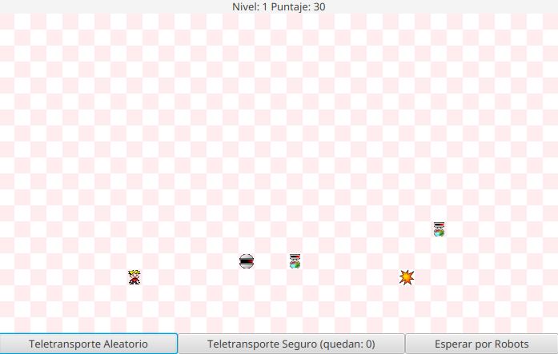

# Robots - Remake

Remake del juego **Robots** de Linux, desarrollado como parte de un trabajo
práctico de la materia **Paradigmas de Programación**.

## Integrantes

* [Candela Matelica](https://github.com/candematelica) - 110641
* [Jesabel Pugliese](https://github.com/jesapugliese) - 110860

## Descripción

El objetivo del juego es sobrevivir a los robots que persiguen al jugador.
En cada turno, el jugador puede moverse o esperar, y luego los robots avanzan
hacia su posición. Cuando dos robots ocupan la misma celda, chocan y son
destruidos. El jugador gana el nivel cuando logra destruir a todos los robots,
y pierde si termina en la misma celda que uno de ellos.

Hay robots simples, que avanzan un paso por turno, y robots dobles, que avanzan
dos pasos. Los robots destruidos otorgan puntos: los simples dan 10 puntos y
los dobles, 20. Al superar un nivel aumenta la cantidad de robots y se obtiene
un uso adicional del teletransporte seguro.

Al iniciar una partida se puede elegir la cantidad de filas y columnas de la
grilla. Ambas dimensiones deben estar entre 20 y 50; la configuración
predeterminada es de 20 filas por 35 columnas.

## Controles

El movimiento se realiza con el teclado:

| Tecla | Acción |
| --- | --- |
| `W` | Moverse hacia arriba |
| `X` | Moverse hacia abajo |
| `A` | Moverse hacia la izquierda |
| `D` | Moverse hacia la derecha |
| `Q` | Moverse en diagonal hacia arriba e izquierda |
| `E` | Moverse en diagonal hacia arriba y derecha |
| `Z` | Moverse en diagonal hacia abajo e izquierda |
| `C` | Moverse en diagonal hacia abajo y derecha |
| `S` | Permanecer en la misma posición y esperar a los robots |

También están disponibles los siguientes botones:

- **Teletransporte Aleatorio**: mueve al jugador a una posición aleatoria.
- **Teletransporte Seguro**: permite seleccionar una celda de la grilla para
  teletransportarse sin moverse durante ese turno. Comienza con un uso y
  obtiene uno adicional al superar cada nivel.
- **Esperar por Robots**: no mueve al jugador y hace avanzar a los robots.

## Requisitos

- Java 22 o superior.
- Maven 3.8 o superior.

El proyecto utiliza JavaFX 22 y Maven descarga sus dependencias
automáticamente durante la compilación.

## Ejecución

Desde la raíz del repositorio, ejecutar:

```bash
mvn clean javafx:run
```

Al abrirse la ventana, seleccionar la cantidad de filas y columnas de la
grilla. Para que el teclado responda, la ventana debe tener el foco.

## Vista del juego


